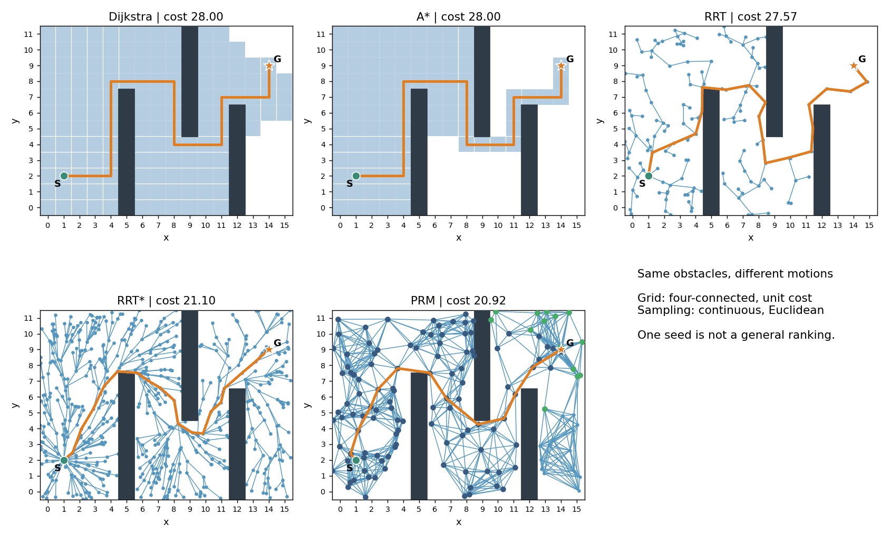
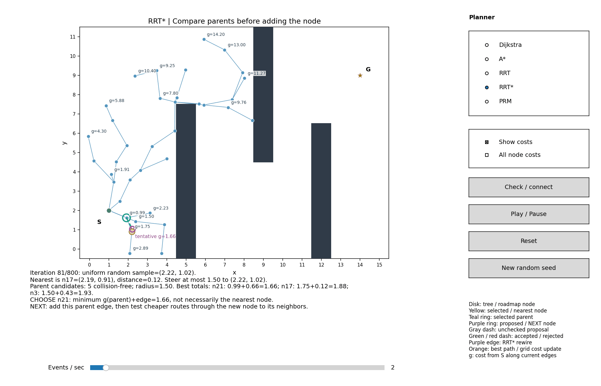

# Robot Path Planning

Learn **Dijkstra, A\*, RRT, RRT\*, and PRM** through theory, worked examples, and a step-by-step Python simulator.



## Start here

1. Read [planning basics](docs/00_planning_basics.md).
2. Work through [Dijkstra and A\*](docs/01_dijkstra_astar.md), [RRT](docs/02_rrt.md), [RRT\*](docs/03_rrt_star.md), and [PRM](docs/04_prm.md).
3. Run the simulator and follow the [guided activities](docs/05_simulation_activities.md).
4. Explore the [optional online simulators, YouTube videos, and MATLAB project](docs/06_resources.md).

**PRM** means Probabilistic Roadmap.

## Run the simulator

Requires **Python 3.10+**, Matplotlib, and a graphical desktop. No ROS, Unity, MATLAB, or physical robot is required.

Download the repository with **Code → Download ZIP**, extract it, and open a terminal in the extracted folder.

Windows:

```powershell
py -m pip install -r simulators/requirements.txt
py simulators/path_planning_sim.py
```

macOS or Linux:

```bash
python3 -m pip install -r simulators/requirements.txt
python3 simulators/path_planning_sim.py
```

Use the same interpreter for installation and execution. If your Python installation requires a virtual environment, create and activate one first. Run as a desktop script; an inline notebook backend does not provide the intended controls.

## Watch the decisions

- **Dijkstra and A\*:** select the next node first, predict its neighbors' costs, then click **Inspect neighbors** to reveal updates.
- **RRT:** preview the random sample, nearest node, proposed disk, and candidate cost before checking its edge.
- **RRT\*:** compare candidate parents by accumulated cost before adding the node, then watch purple rewired edges and improvements to the orange best path. It keeps searching after its first solution.
- **PRM:** watch free samples, validated roadmap edges, then a two-phase Dijkstra query.
- **Play / Pause**, **Reset**, **New random seed**, and **Events / sec** control playback.

**Node disks and costs:** filled disks mark tree and roadmap vertices. The explanation panel identifies the next node or connection and explains why it is chosen. **Show costs** displays grid g+h=f or sampling-tree g from S; **All node costs** reveals every known cost. By default, dense trees label recent and relevant nodes so the map stays readable. Marker disks are visual symbols, not robot footprints.



The five planners share obstacle geometry. Grid planners use four-connected moves; sampling planners move continuously, so their route lengths are not a direct optimality contest.

## Optional resources

- [MySimulator path planning simulator](https://www.mysimulator.uk/algorithms/path-planning-algorithm/sim.html)
- [PhysSandbox A\* and Dijkstra simulator](https://physandbox.com/engineering/astar-dijkstra-grid)
- [A\* and RRT overview video](https://www.youtube.com/watch?v=QR3U1dgc5RE&list=PLaH6cYVpQeoM&index=1)
- [Sebastian Lague A\* explanation](https://www.youtube.com/watch?v=-L-WgKMFuhE)
- [RRT RRT\* PRM comparison video](https://www.youtube.com/watch?v=gP6MRe_IHFo)
- [MATLAB multi-algorithm robot navigation](https://github.com/ruddrho/matlab-multi-algorithm-robot-navigation)

See [resources](docs/06_resources.md) for what to try and watch.

## Verify

```bash
python -m unittest discover -s tests -v
python simulators/path_planning_sim.py --check
```

This is a teaching implementation for a point robot in a known 2D environment. Actual robots need footprint handling, motion constraints, timing, and feedback control.

