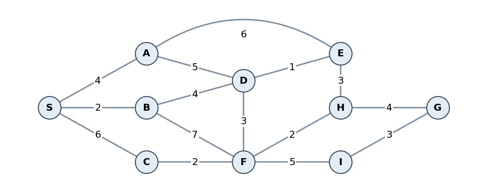
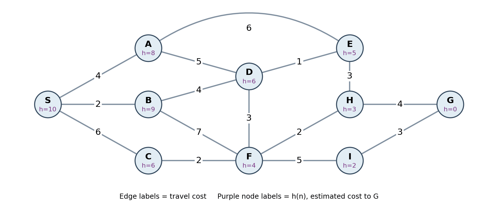
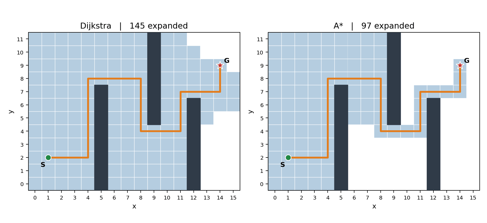

# Dijkstra and A star

Both planners search a graph. A grid is one possible graph: free cells are nodes and valid moves are edges.

The graph has ten nodes and fifteen bidirectional edges. Edge labels are travel costs, not geometric distances. Alphabetical order breaks equal-priority ties in this worked example.

## Dijkstra

Let **g(n)** be the best known cost from S to n. Initialize g(S)=0 and all other costs to infinity. Store frontier nodes in a minimum priority queue.

1. Remove the node with smallest g; ignore stale queue entries.
2. If it is G, recover the route through parent pointers.
3. For each outgoing edge u→v, compute candidate=g(u)+c(u,v).
4. If candidate<g(v), update g(v), change its parent to u, and update the queue.
5. Repeat until the goal is expanded or the frontier is empty.

This update is called **relaxation**. For nonnegative edge costs, Dijkstra finds a minimum-cost route on the graph. Stop when the goal is removed for expansion, not when it is first discovered.

### Complete worked trace

| Step | Expand | g | Updates |
| --- | --- | --- | --- |
| 1 | S | 0 | A: ∞ → 4; B: ∞ → 2; C: ∞ → 6 |
| 2 | B | 2 | D: ∞ → 6; F: ∞ → 9 |
| 3 | A | 4 | E: ∞ → 10 |
| 4 | C | 6 | F: 9 → 8 |
| 5 | D | 6 | E: 10 → 7 |
| 6 | E | 7 | H: ∞ → 10 |
| 7 | F | 8 | I: ∞ → 13 |
| 8 | H | 10 | G: ∞ → 14 |
| 9 | I | 13 | No improvement |
| 10 | G | 14 | Stop |

Final path: **S → B → D → E → H → G**. Cost=2+4+1+3+4=**14**.

F is first reached with cost 9 through B, then improved to 8 through C. E is first reached with cost 10 through A, then improved to 7 through D. The first discovered parent is not necessarily the final parent.

The alternative S→C→F→I→G costs 16. S→A→E→H→G costs 17. Fewer edges do not necessarily mean lower total cost.

## A star

A\* ranks frontier nodes by **f(n)=g(n)+h(n)**. The heuristic h estimates cost remaining to G. Setting h=0 gives Dijkstra.

The copy below keeps every edge cost unchanged and labels each node with its fixed heuristic h(n). This makes the A* calculation visible without switching between the graph and a table.

Edge labels are travel costs; purple labels inside nodes are estimates of remaining cost to G. These are fixed heuristic estimates, not accumulated costs from S. During the trace, calculate g(n) from the route found so far, then f(n)=g(n)+h(n). Keep h on the reference graph and record changing g and f values in the trace table.

Use these heuristics for the same weighted graph:

| Node | S | A | B | C | D | E | F | H | I | G |
| --- | --- | --- | --- | --- | --- | --- | --- | --- | --- | --- |
| h | 10 | 8 | 9 | 6 | 6 | 5 | 4 | 3 | 2 | 0 |

These numbers are chosen consistent lower bounds, not distances measured from the drawing.

### Complete worked trace

| Step | Expand | g | h | f | Updates |
| --- | --- | --- | --- | --- | --- |
| 1 | S | 0 | 10 | 10 | A: ∞ → 4; B: ∞ → 2; C: ∞ → 6 |
| 2 | B | 2 | 9 | 11 | D: ∞ → 6; F: ∞ → 9 |
| 3 | A | 4 | 8 | 12 | E: ∞ → 10 |
| 4 | C | 6 | 6 | 12 | F: 9 → 8 |
| 5 | D | 6 | 6 | 12 | E: 10 → 7 |
| 6 | E | 7 | 5 | 12 | H: ∞ → 10 |
| 7 | F | 8 | 4 | 12 | I: ∞ → 13 |
| 8 | H | 10 | 3 | 13 | G: ∞ → 14 |
| 9 | G | 14 | 0 | 14 | Stop |

After B, D has g=2+4=6 and f=6+6=12. F initially has g=2+7=9 and f=9+4=13.

After C, F improves to g=6+2=8 and f=8+4=12.

After H, G has f=14; I has g=13 but f=15. A\* selects G and stops without expanding I. Both planners return cost 14. This graph saves only one expansion; a small example should not imply that the saving is always large.

### Heuristics for a robot grid

| Allowed motion and cost | Appropriate lower bound |
|---|---|
| Four-connected; every step costs 1 | Manhattan: h=dx+dy |
| Eight-connected; cardinal cost 1, diagonal cost √2 | Octile: h=max(dx,dy)+(√2−1)min(dx,dy) |
| Euclidean distance lower-bounds travel cost | Euclidean: h=√(dx²+dy²) |

Here dx=abs(x−xG), dy=abs(y−yG). Heuristic and path-cost units must agree. For travel time, distance divided by a valid maximum speed can provide a lower bound.

**Admissible:** h never overestimates true remaining cost. **Consistent:** h(u)≤c(u,v)+h(v) for every edge, with h(G)=0. For example h(C)=6≤2+h(F)=6.

With consistency, standard graph A\* can close expanded nodes permanently. With admissibility alone, an implementation must reopen nodes when a better g is found to retain the usual optimality guarantee. Overestimating can sacrifice optimality.

## Larger map and two separate teaching phases

The shared simulation uses a 16×12 grid, S=(1,2), G=(14,9), and three staggered walls. Unit-cost four-connected motion gives a start heuristic of 20, but the optimal grid route costs 28.

| Planner | Path cost | Expanded cells including G |
|---|---:|---:|
| Dijkstra | 28 | 145 |
| A\* | 28 | 97 |

Grid neighbors are considered right, up, left, down. Dijkstra ties use insertion order; A\* prefers smaller h, then insertion order. Counts and chosen equal-cost routes can change with these rules.

**Select next node** first highlights the selected cell without updating its neighbors. **Inspect neighbors** reveals cost updates on the following click. Previously discovered costs stay visible. Playback preserves both phases.

Next: [RRT](02_rrt.md).
