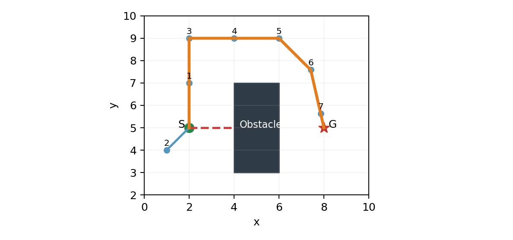

# Rapidly exploring Random Tree

RRT grows a tree rooted at the start. Sampling tends to attract expansion toward unexplored space.

## One iteration

1. Sample q_rand. Sometimes sample the goal (goal bias).
2. Find the nearest tree node q_near.
3. Steer toward the sample by at most η to obtain q_new.
4. Validate the entire edge q_near→q_new. Reject it if invalid.
5. Add a valid node and parent edge.
6. When near the goal, validate the goal connection and recover the parent chain.

For a 2D point robot:

q_new = q_near + min(1, η / ||q_rand−q_near||) (q_rand−q_near).

Skip a zero-distance sample. A robot with turning or dynamic constraints needs a different steering method.

## Worked sample sequence

S=(2,5), G=(8,5), η=2. The obstacle is the closed rectangle 4≤x≤6 and 3≤y≤7. Touching its boundary counts as collision. These samples are prescribed for hand calculation, not generated by the simulator's random seed.

| Step | Sample | Nearest | Proposed | Result |
| --- | --- | --- | --- | --- |
| 1 | (8,5) | (2,5) | (4,5) | Reject |
| 2 | (2,8) | (2,5) | (2,7) | Accept |
| 3 | (1,4) | (2,5) | (1,4) | Accept |
| 4 | (2,9) | (2,7) | (2,9) | Accept |
| 5 | (5,9) | (2,9) | (4,9) | Accept |
| 6 | (8,9) | (4,9) | (6,9) | Accept |
| 7 | (8,7) | (6,9) | (7.41,7.59) | Accept |
| 8 | (8,5) | (7.41,7.59) | (7.86,5.64) | Accept |

Step 1 is rejected because (4,5) touches the obstacle. Step 3 grows a side branch from S: the nearest node is not necessarily the most recently inserted node.

For step 7, the displacement from (6,9) toward (8,7) has length √8. Thus q_new=(6,9)+(2/√8)(2,−2)≈(7.414,7.586).

After step 8, the goal is about 0.651 units from the last node; its final edge is valid. The recovered route is S→(2,7)→(2,9)→(4,9)→(6,9)→(7.414,7.586)→(7.856,5.635)→G, with length about **12.65**. The direct distance 6 crosses the obstacle.

The side branch is valid but is not on the returned parent chain.

## What is guaranteed

Basic RRT seeks a feasible route; the first route is not generally optimal. It is probabilistically complete under standard sampling, clearance, and local-connection assumptions. Finite-budget failure does not prove no solution exists. Basic RRT is not asymptotically optimal.

For a six-joint arm, 100 values per joint would give 100⁶ grid configurations. Sampling can avoid enumerating the whole grid, but robot-specific collision checking is still essential.

The simulator uses seed=7, step=1.5, goal bias=0.1, and a 5000-iteration budget. New random seed changes the tree. Reset repeats the seed.

Next: [RRT\*](03_rrt_star.md).
